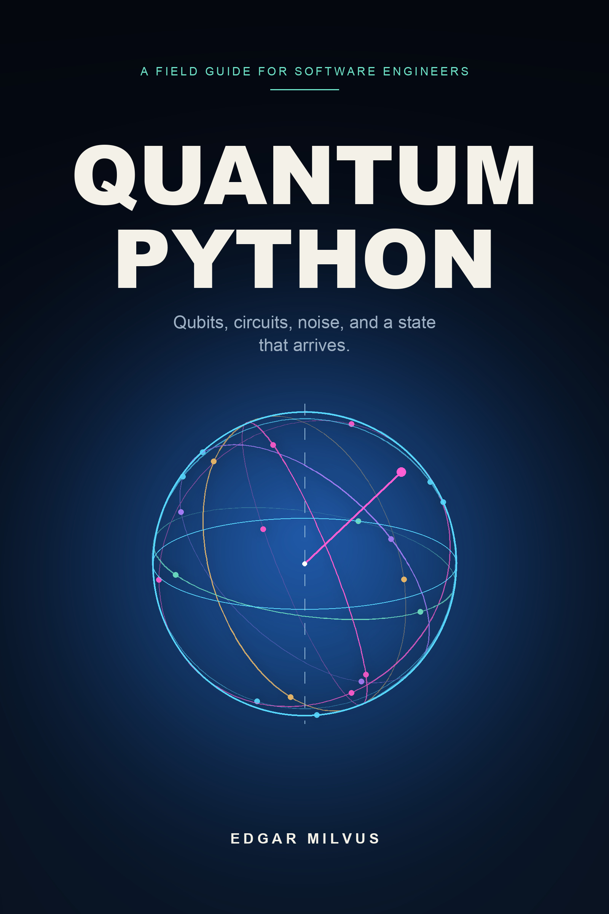

# Quantum Python — sources, code, and the runs behind the book

The repository for *Quantum Python* by Edgar Milvus: twenty chapters that take a senior
software engineer from a complex amplitude to a priced, corrected, replayable pipeline,
with no physics assumed.

It holds one contract per chapter, the code each chapter publishes, the recorded runs the
prose quotes, and the scripts that rerun them. One command takes a fresh clone to a green
suite:

```bash
./run_offline.sh all          # or: python3 run_offline.py
```

Every chapter ships a harness that asserts on real numbers and five exercises with their
own checks. Across the twenty chapters that is **2,629 assertions**, and the whole suite
runs offline in about fifty seconds.

## The Book



*Quantum Python* takes a senior software engineer from a complex amplitude to a
teleportation experiment on a real device, with twenty chapters that each end in runnable
code, a recorded run and five exercises.

[for additional information](https://tiny.cc/QuantumPython)

## The chapters

| # | chapter | assertions | files |
| --- | --- | --- | --- |
| 1 | [The Qubit Is a Vector](chapters/chapter01/) | 143 | 19 |
| 2 | [Two Qubits, and the Order That Bites](chapters/chapter02/) | 135 | 18 |
| 3 | [Circuits, Unitaries, Compilation](chapters/chapter03/) | 129 | 21 |
| 4 | [Entanglement and the CHSH Inequality](chapters/chapter04/) | 102 | 16 |
| 5 | [Shots, Statistics, Error Bars](chapters/chapter05/) | 100 | 18 |
| 6 | [Oracles: Deutsch-Jozsa and Bernstein-Vazirani](chapters/chapter06/) | 206 | 18 |
| 7 | [Grover and Amplitude Amplification](chapters/chapter07/) | 111 | 16 |
| 8 | [The Quantum Fourier Transform and Phase Estimation](chapters/chapter08/) | 145 | 17 |
| 9 | [Order Finding and Shor-lite](chapters/chapter09/) | 174 | 16 |
| 10 | [VQE for the Hydrogen Molecule](chapters/chapter10/) | 106 | 18 |
| 11 | [One Interface, Seven Providers](chapters/chapter11/) | 93 | 23 |
| 12 | [Noise and Error Mitigation](chapters/chapter12/) | 180 | 23 |
| 13 | [QAOA and Combinatorial Optimization](chapters/chapter13/) | 162 | 21 |
| 14 | [Annealing and the D-Wave Problem](chapters/chapter14/) | 138 | 20 |
| 15 | [Quantum Machine Learning](chapters/chapter15/) | 123 | 20 |
| 16 | [Error Correction](chapters/chapter16/) | 133 | 18 |
| 17 | [Dynamic Circuits](chapters/chapter17/) | 98 | 18 |
| 18 | [The Benchmark](chapters/chapter18/) | 112 | 18 |
| 19 | [The Pipeline](chapters/chapter19/) | 113 | 19 |
| 20 | [The Last Experiment](chapters/chapter20/) | 126 | 20 |

Each chapter folder holds `spec.yaml` (the contract: floor, gate counts and files) and
`files/` with the code the chapter publishes. The prose itself is the book; this repository is what it runs. Every `**How to run it.**`
block in the prose names the file it belongs to, and the listing in the book is the file
byte for byte.

## Setup

Python 3.11 or 3.12.

```bash
python3.11 -m venv .venv
source .venv/bin/activate
python3 -m pip install -r requirements.txt
```


## Run offline

The whole book, no key and no network:

```bash
./run_offline.sh all
```

or, without a POSIX shell:

```bash
python3 run_offline.py
```

Both walk the chapters in order and run each chapter's harness, then its five exercises.
The suite covers 2,629 assertions, takes about a minute, and ends `all chapters green`:

```
== chapter20
63/63 checks passed
75/75 exercise checks passed
...
all chapters green
``` One chapter, while
you are working on it:

```bash
./run_offline.sh chapter18
python3 run_offline.py chapter18
```

One chapter's code without any runner:

```bash
cd chapters/chapter20/files
python3 05_report.py
```

## Running every live experiment

To run every live experiment you need to set these seven environment variables:

```bash
export QISKIT_IBM_TOKEN="..."           # secret
export QISKIT_IBM_INSTANCE="crn:v1:bluemix:public:quantum-computing:..."
export QISKIT_IBM_CHANNEL="ibm_quantum_platform"
export QBRAID_API_KEY="..."             # secret
export IONQ_API_KEY="..."               # secret
export QUANTUM_LIVE=1
export QUANTUM_MAX_SPEND_USD=5
```

You can put them in the repository's `.env` — every script reads that file — or in your
`~/.env`, loaded with `set -a; source ~/.env; set +a`. `.env` is git-ignored.

| variable | where it comes from |
| --- | --- |
| `QISKIT_IBM_TOKEN` | <https://cloud.ibm.com/iam/apikeys> → Create → copy the key |
| `QISKIT_IBM_INSTANCE` | <https://quantum.cloud.ibm.com/instances> → open the Open Plan instance → copy its CRN |
| `QBRAID_API_KEY` | <https://account.qbraid.com/> → Profile → API keys → Create |
| `IONQ_API_KEY` | <https://cloud.ionq.com/settings/keys> → Create API key |
| Quantum Inspire | no key: sign up at <https://compute.quantum-inspire.com/> and run `qi login` once |
| `QUANTUM_LIVE`, `QUANTUM_MAX_SPEND_USD` | set them yourself; they are not secrets |

### Quantum Inspire, once per machine

Quantum Inspire does not use an API key. It authenticates once with a device code and
stores the token in `~/.quantuminspire/config.json`:

```bash
qi logout
qi login
```

The command prints a URL and a code such as `RWXD-CGJS`. The browser opens the
confirmation page: check that the code on the page is the same one the terminal printed,
then click **Confirm**. The terminal answers `Login successful! Using member ID ...`. If
the browser does not open, copy the URL the command printed.

If the login fails with `403` and `invalid_grant` — `Unknown or invalid refresh token` —
the stored token is stale. Force a new one:

```bash
qi login --force --override-auth-config
```

or move `~/.quantuminspire/config.json` aside and run `qi login` again. `qi backends` shows
the devices and their status once the login works; with the Tuna machines offline, the QX
emulator is the one that answers, and `python live_scripts/hello_qi.py` prints its counts.

Then run these, in this order. Each one submits a job and writes its record under
`runs/chapterNN/`.

```bash
python3 live_scripts/check_providers.py --check        # who answers; submits nothing

python3 live_scripts/hello_ibm.py              # IBM smoke test, 1 x 1,024
python3 live_scripts/hello_ionq.py             # IonQ simulator, free
python3 live_scripts/hello_qi.py               # Quantum Inspire, after `qi login`

python3 live_scripts/chapter04/submit_chsh.py          # chapter 4,  4 x 1,024
python3 live_scripts/chapter06/submit_bv.py            # chapter 6,  1 x 1,024
python3 live_scripts/chapter07/submit_grover.py        # chapter 7,  1 x 1,024
python3 live_scripts/chapter10/submit_vqe.py           # chapter 10, 2 x 10,000
python3 live_scripts/chapter12/submit_readout.py       # chapter 12, 4 x 4,096
python3 live_scripts/chapter13/submit_qaoa.py          # chapter 13, 36 x 1,024
python3 live_scripts/chapter15/submit_kernel.py        # chapter 15, 57 x 1,024
python3 live_scripts/chapter16/submit_repetition.py    # chapter 16, 12 x 4,096
python3 live_scripts/chapter16/submit_idle.py          # chapter 16, 12 x 4,096
python3 live_scripts/chapter17/submit_dynamic.py       # chapter 17, 8 x 4,096
python3 live_scripts/chapter17/submit_inject.py        # chapter 17, 6 x 4,096
python3 live_scripts/chapter17/submit_latency.py       # chapter 17, 3 x 4,096
python3 live_scripts/chapter17/submit_syndrome.py      # chapter 17, 2 x 8,192
python3 live_scripts/chapter18/submit_ghz.py           # chapter 18, IBM + qBraid
python3 live_scripts/chapter19/submit_bv_pipeline.py   # chapter 19, 6 x 2,048
python3 live_scripts/chapter20/submit_teleport.py      # chapter 20, 13 x 2,048

python3 chapters/chapter11/files/02_live_or_replay.py  # chapter 11, honours QUANTUM_LIVE
```

A full pass is about **two minutes of QPU** and **thirty to sixty minutes of wall clock**,
almost all of it in the queue. The IBM open plan gives ten minutes of QPU per 28 days,
which is the real budget; qBraid and IonQ's simulator are free.

One thing to know before you start: the submit scripts send as soon as they are invoked
and do not read `QUANTUM_LIVE`; that variable, and the five-dollar ceiling, guard chapter
11's provider interface instead.

### After the live runs

The scripts have overwritten the records under `runs/chapterNN/` with your own counts, and
the harnesses assert the numbers the book prints. Put the book's records back with:

```bash
git checkout -- runs/
```

A folder the scripts created that the repository does not track stays after that; remove it
with `git clean -fd runs/`. If you want to keep your results, run the experiments in a
second clone.

## Windows

Native Windows works.

```powershell
python -m venv .venv
.venv\Scripts\python -m pip install -r requirements.txt

.venv\Scripts\python run_offline.py
.venv\Scripts\python run_offline.py chapter20
```

The live experiments run from the same shell. Put the seven variables in the repository's
`.env` — the scripts read it, so no `$env:` line is needed — or set them for the session:

```powershell
$env:QISKIT_IBM_TOKEN = "..."
$env:QISKIT_IBM_INSTANCE = "crn:v1:bluemix:public:quantum-computing:..."
$env:QISKIT_IBM_CHANNEL = "ibm_quantum_platform"
$env:QBRAID_API_KEY = "..."
$env:IONQ_API_KEY = "..."
$env:QUANTUM_LIVE = "1"
$env:QUANTUM_MAX_SPEND_USD = "5"
```

Then the live runs, in the same order as the section above:

```powershell
.venv\Scripts\python live_scripts\check_providers.py --check
.venv\Scripts\python live_scripts\hello_ibm.py
.venv\Scripts\python live_scripts\hello_ionq.py
.venv\Scripts\python live_scripts\hello_qi.py

.venv\Scripts\python live_scripts\chapter04\submit_chsh.py
.venv\Scripts\python live_scripts\chapter06\submit_bv.py
.venv\Scripts\python live_scripts\chapter07\submit_grover.py
.venv\Scripts\python live_scripts\chapter10\submit_vqe.py
.venv\Scripts\python live_scripts\chapter12\submit_readout.py
.venv\Scripts\python live_scripts\chapter13\submit_qaoa.py
.venv\Scripts\python live_scripts\chapter15\submit_kernel.py
.venv\Scripts\python live_scripts\chapter16\submit_repetition.py
.venv\Scripts\python live_scripts\chapter16\submit_idle.py
.venv\Scripts\python live_scripts\chapter17\submit_dynamic.py
.venv\Scripts\python live_scripts\chapter17\submit_inject.py
.venv\Scripts\python live_scripts\chapter17\submit_latency.py
.venv\Scripts\python live_scripts\chapter17\submit_syndrome.py
.venv\Scripts\python live_scripts\chapter18\submit_ghz.py
.venv\Scripts\python live_scripts\chapter19\submit_bv_pipeline.py
.venv\Scripts\python live_scripts\chapter20\submit_teleport.py

.venv\Scripts\python chapters\chapter11\files\02_live_or_replay.py
```

`run_offline.sh` is a bash script; `run_offline.py` is its twin and takes the same
argument. A single chapter's program runs the same way:

```powershell
cd chapters\chapter20\files
..\..\..\.venv\Scripts\python 05_report.py
```

Paths in the code come from `pathlib`, so a run writes `chapters\chapter20\...` where the
book shows `chapters/chapter20/...`; that is the only difference.

## Layout

```
chapters/chapterNN/
  spec.yaml                 the contract: floor, gate counts, artifacts, exercises
  files/                    the listings, the demos, the harness
  files/exercises/          the five exercises, their checks and the runner
runs/chapterNN/<id>-<name>/  one recorded experiment: result.json or gate/output
runs/INDEX.md               the one row every run has
live_scripts/               provider check, hello scripts, one folder per chapter
run_offline.sh              the suite, POSIX shell
run_offline.py              the same suite, shell-free
requirements.txt            the pinned stack
LICENSE                     MIT, for the code
LICENSE-BOOK.md             the book is © Edgar Milvus, all rights reserved
```

## Licence

The code in this repository is released under the **MIT License**; see `LICENSE`. Use it,
change it, ship it, including commercially, as long as the copyright notice travels with
it.

The **book is not MIT**: the text, the figures and the diagrams are © 2026 Edgar Milvus,
all rights reserved. Quoting a listing or a paragraph in a review or a course is fine;
redistributing the book is not. `LICENSE-BOOK.md` has the exact terms.

## When something does not start

| message | what it means |
| --- | --- |
| `ModuleNotFoundError: No module named 'qiskit'` | the virtual environment is not active, or `pip install -r requirements.txt` was never run in it |
| `no spec: chapters/chapter20/spec.yaml` | run the commands from the repository root, where the chapter globs resolve |
| `refused: 984.84 USD is over the 5.00 budget` | the pipeline working as designed: the estimate prices a job before it is submitted |
| `no key` in a live script | `.env` is missing or empty: copy `.env.example` and set the key for that provider |

## Checks

Each chapter's own files are the check: `chapters/chapterNN/files/run_exNN.py` asserts on
the chapter's numbers and exits non-zero when one is wrong, and
`chapters/chapterNN/files/exercises/run_exercises.py` runs the five exercises' checks.
`run_offline.sh` and `run_offline.py` are only a loop over those two files, so a chapter
that prints `NN/NN checks passed` and `NN/NN exercise checks passed` is green.
